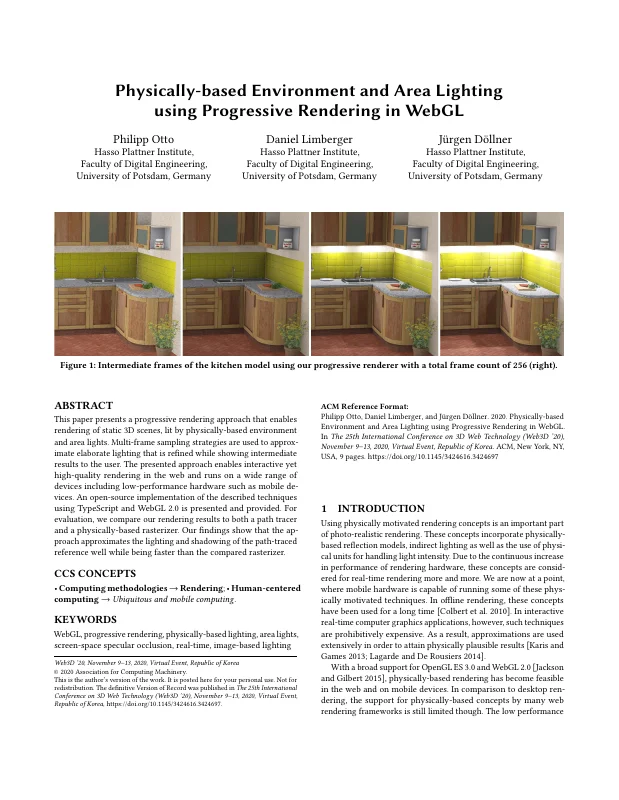
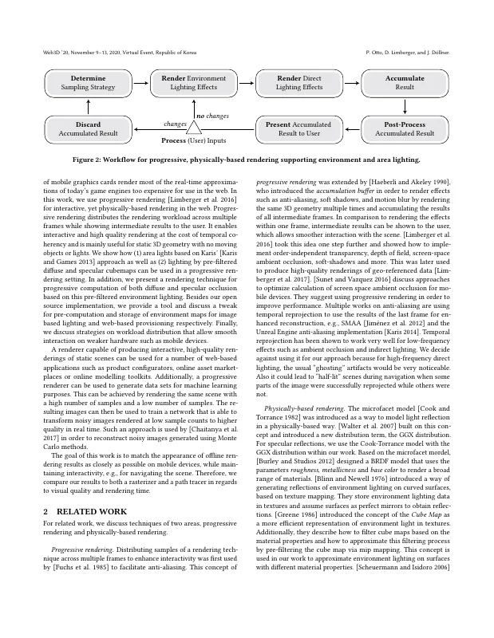
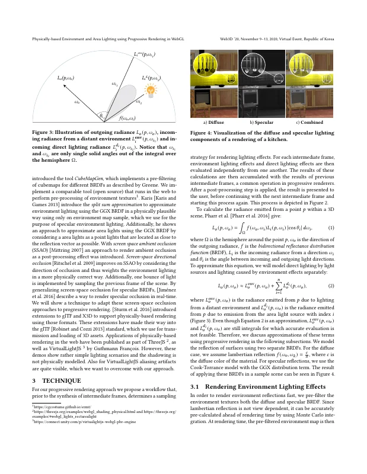
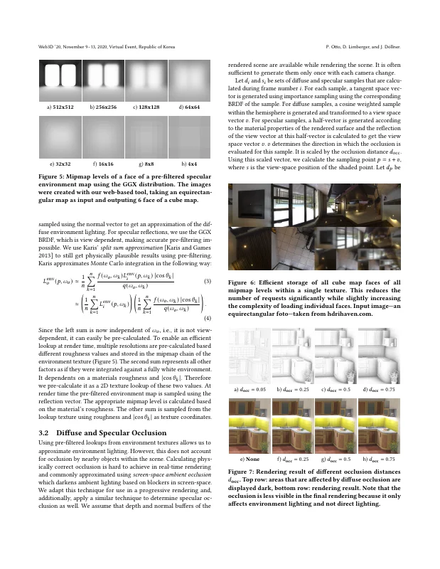
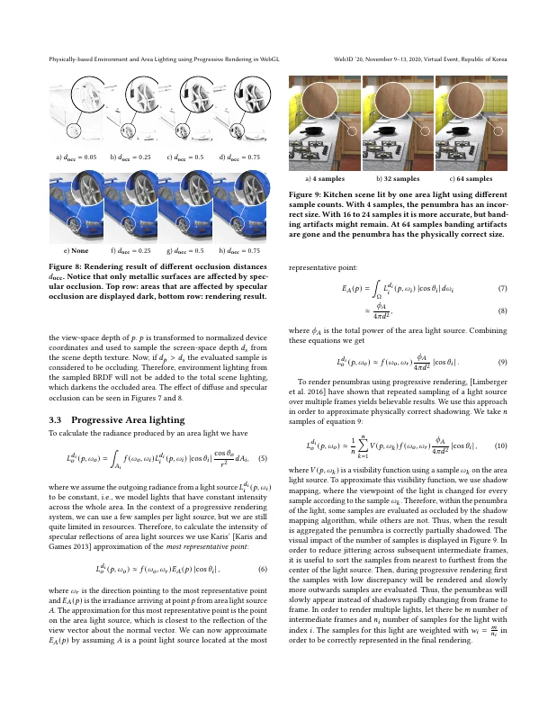
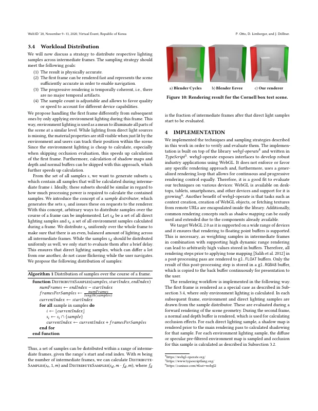
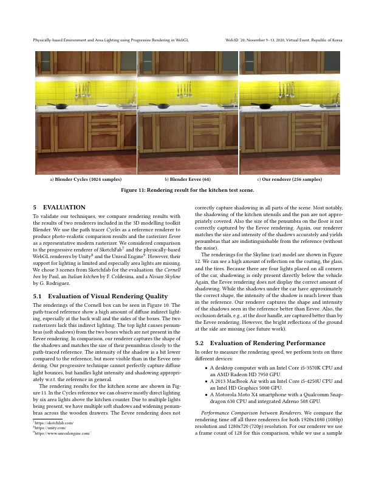
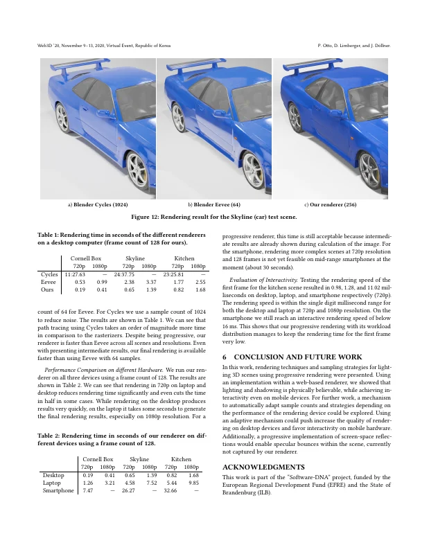
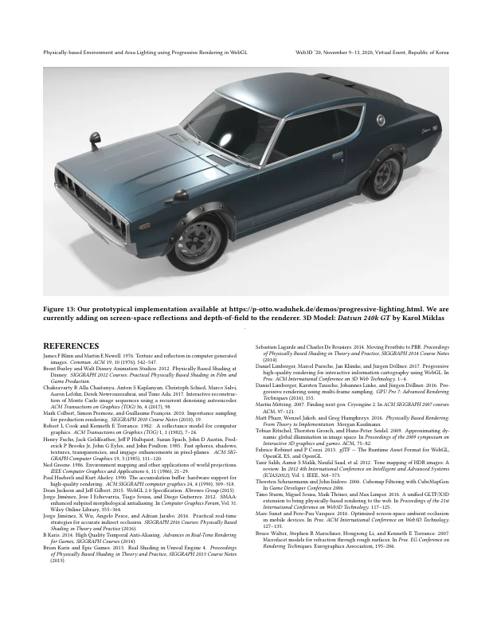

# Physically-based Environment and Area Lighting using Progressive Rendering in WebGL

Philipp Otto, [Daniel Limberger](https://orcid.org/0000-0002-9111-4809), and [Jürgen Döllner](https://orcid.org/0000-0002-8981-8583)

*Proceedings of the 25th International Conference on 3D Web Technology (Web3D '20)*, November 9–13, 2020, Virtual Event, Republic of Korea. ACM, pp. 15:1–9.

DOI: [10.1145/3424616.3424697](https://doi.org/10.1145/3424616.3424697) · Author's version: [Zenodo](https://doi.org/10.5281/zenodo.24061872) · [ResearchGate](https://www.researchgate.net/publication/347578774)

> This paper presents a progressive rendering approach that enables rendering of static 3D scenes, lit by physically-based environment and area lights.
> Multi-frame sampling strategies are used to approximate elaborate lighting that is refined while showing intermediate results to the user.
> The presented approach enables interactive yet high-quality rendering in the web and runs on a wide range of devices including low-performance hardware such as mobile devices.
> An open-source implementation of the described techniques using TypeScript and WebGL 2.0 is presented and provided.
> For evaluation, we compare our rendering results to both a path tracer and a physically-based rasterizer.
> Our findings show that the approach approximates the lighting and shadowing of the path-traced reference well while being faster than the compared rasterizer.

<p><a href="otto2020-pbr-lighting-as-submitted.pdf"></a> <a href="otto2020-pbr-lighting-as-submitted.pdf"></a> <a href="otto2020-pbr-lighting-as-submitted.pdf"></a> <a href="otto2020-pbr-lighting-as-submitted.pdf"></a></p>
<details><summary>All 9 pages</summary><p><a href="otto2020-pbr-lighting-as-submitted.pdf"></a> <a href="otto2020-pbr-lighting-as-submitted.pdf"></a> <a href="otto2020-pbr-lighting-as-submitted.pdf"></a> <a href="otto2020-pbr-lighting-as-submitted.pdf"></a> <a href="otto2020-pbr-lighting-as-submitted.pdf"></a></p></details>

## Contents

- [`src/`](src/) – LaTeX sources of the camera-ready version (ACM `acmart`, sigconf, `authorversion`)
- [`otto2020-pbr-lighting-as-submitted.pdf`](otto2020-pbr-lighting-as-submitted.pdf) – author's version PDF built from these sources (Overleaf, TeX Live 2019)
- [`build.sh`](build.sh) – reproducible build with TeX Live 2019 (podman or docker)
- [`preview/`](preview/) – page previews for this README

## Build

```bash
./build.sh        # → build/main.pdf
```

The sources were built on Overleaf with TeX Live 2019 (pdfTeX 1.40.20), hence the TeX Live 2019 container; TeX Live 2020 typesets math slightly differently.
On `main`, the build produces the revised version (`v1.1-revised`). Check out `v1.0-camera-ready` to reproduce `otto2020-pbr-lighting-as-submitted.pdf` (identical text and layout).

## Versions

- [`v1.0-camera-ready`](https://github.com/dl-archive/article.2020-web3d-pbr-lighting/tree/v1.0-camera-ready) – camera-ready sources (Overleaf author's version, 2021-08-12)
- [`v1.1-revised`](https://github.com/dl-archive/article.2020-web3d-pbr-lighting/tree/v1.1-revised) – author's revised version (2026-11-08): grammar and reference fixes, see [Revisions](#revisions)

## Revisions

`v1.1-revised` (2026-11-08) corrects errors in the camera-ready version without changing its content or layout.
Every page carries the note "Author's revised version (2026-11-08). Version of record: https://doi.org/10.1145/3424616.3424697".

- Spelling: "model", "Lambertian" (2×), "photo" (Figure 6), "outputting 6 faces" (Figure 5), "Sketchfab", "high-quality", "open-source", "image-based", "view-dependent" (2×), "cosine-weighted", "single-digit", "soft shadows", "outward".
- Grammar and word choice: "at a point where", "the low performance of mobile graphics cards renders", "regarding visual quality", "Karis introduces", "only one environment map sample", "considering area lights as point lights", "for both the diffuse and specular BRDF", "based on different roughness values", "It depends on a material's roughness", "sufficiently accurately", "allows favoring", "as a means to", "on request", "after which", "to calculate shadowing", "three scenes", "the reference shows", "is not appropriately covered", "time of all three", "adding screen-space reflections" (Figure 13), "lighting and shadowing are", "could increase the quality", "Progressive Area Lighting", "on Different Hardware", "Equation", and missing commas.
- Algorithm 1: set union (∪) instead of intersection when adding a sample to $s_i$.
- Figure 13: the demo link now includes `https://`.
- References: "image enhancements" (Fuchs et al.), "ACM SIGGRAPH Computer Graphics" (Haeberli and Akeley), "CryEngine" (Mittring), "glTF/X3D" (Sturm et al.), "Symposium on Interactive 3D Graphics and Games" (Ritschel et al.), "de Rousiers" (Lagarde and de Rousiers).

Not fixed because they would reflow the layout: "Epic Games" and "Walt Disney Animation Studios" appear as co-authors of Karis 2013 and Burley 2012 (they are the authors' employers).

## Citation

```bibtex
@InProceedings{otto2020-pbr-lighting,
  author    = {Otto, Philipp and Limberger, Daniel and D{\"o}llner, J{\"u}rgen},
  title     = {Physically-based Environment and Area Lighting using Progressive Rendering in WebGL},
  booktitle = {Proceedings of the 25th International Conference on 3D Web Technology},
  year      = {2020},
  series    = {Web3D~'20},
  publisher = {ACM},
  pages     = {15:1--9},
  doi       = {10.1145/3424616.3424697},
  isbn      = {978-1-450381-69-7},
}
```
